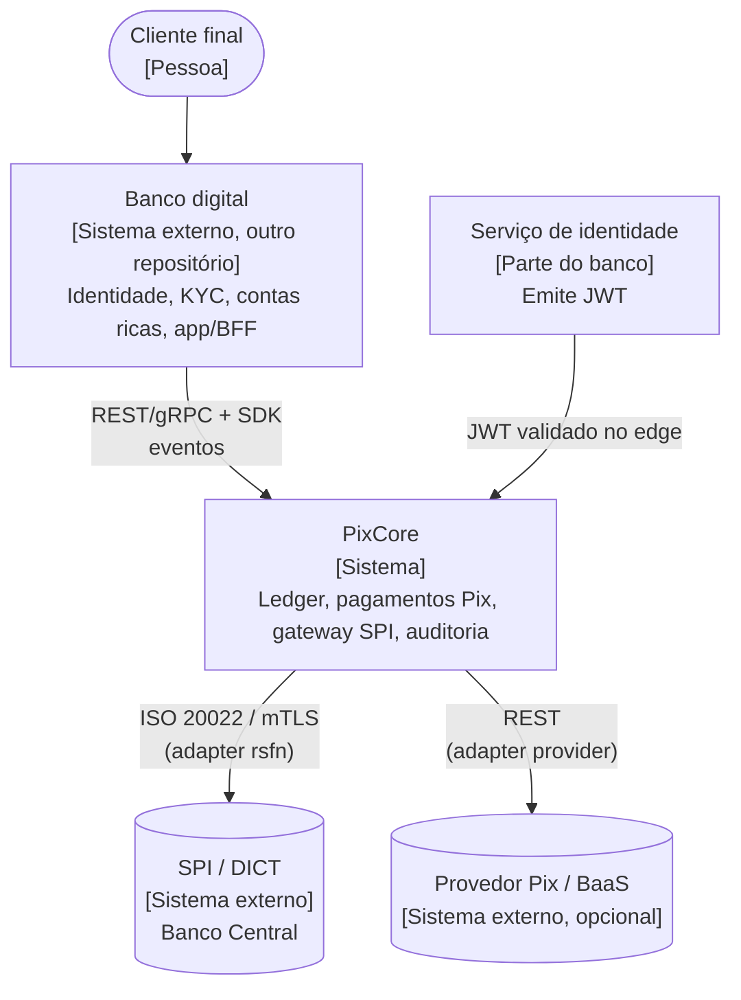
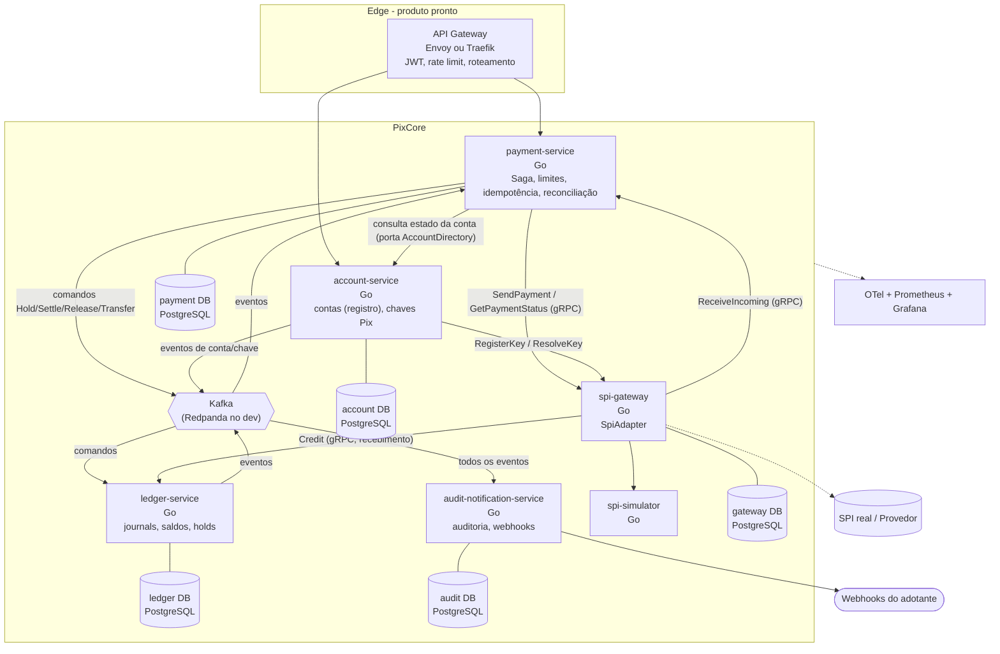
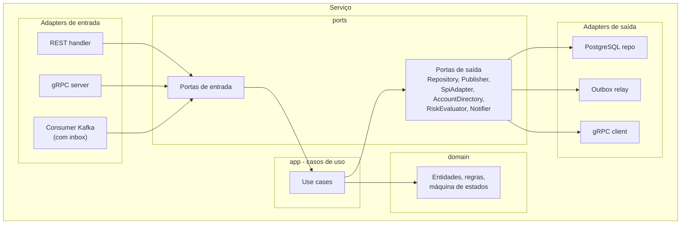
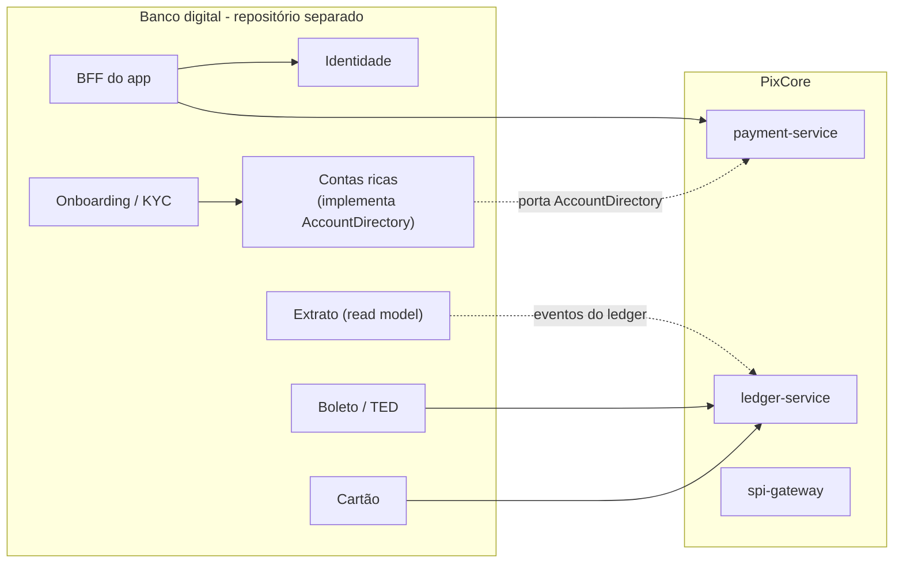

# Arquitetura: visão C4

Diagramas em Mermaid (`flowchart`), seguindo a notação C4 por convenção.

## Nível 1: Contexto

O PixCore é consumido por sistemas de terceiros; o **banco digital** (repositório separado) é o primeiro consumidor. A identidade fica fora.

## Nível 2: Contêineres

> Nota: `ReceiveIncoming` chega do SPI ao `spi-gateway`, que aciona o `payment-service`; o `Credit` no ledger é gRPC síncrono porque o SPI exige resposta rápida. O ponto exato de orquestração do recebimento está em [04-sequences.md](04-sequences.md#3-pix-recebido).

## Nível 3: Componentes (hexagonal, padrão de cada serviço)

## Pontos de extensão (portas)

| Porta | Serviço | Implementação de referência | Substituição típica |
|---|---|---|---|
| `AccountDirectory` | `payment-service`, `account-service` | `account-service` do PixCore | Serviço de contas do banco |
| `RiskEvaluator` | `payment-service` | regras estáticas de limite | Motor antifraude |
| `Notifier` | `audit-notification-service` | webhooks | Push, e-mail, fila própria |
| `SpiAdapter` | `spi-gateway` | `simulator` | `provider`, `rsfn` |

## Mapa de contextos (Fase 2, visão)

