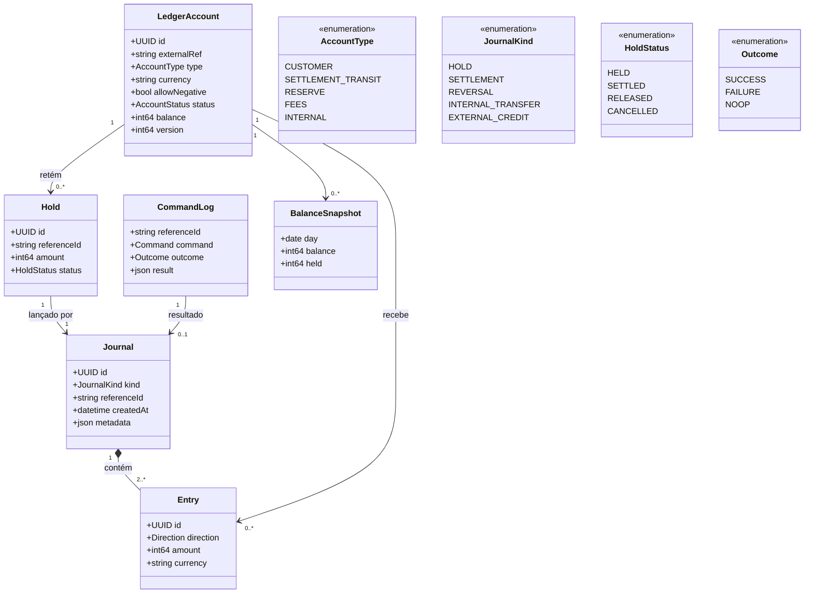
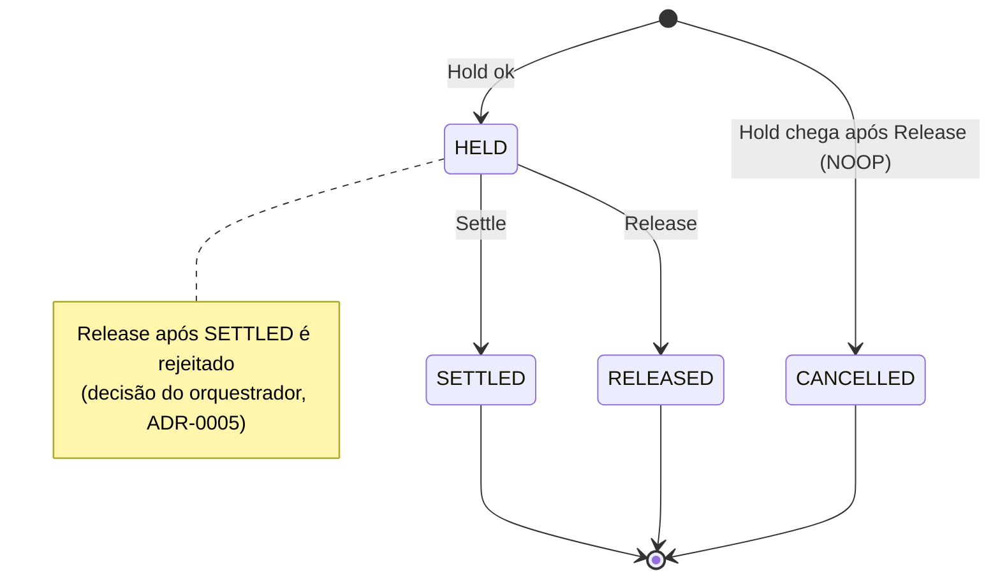
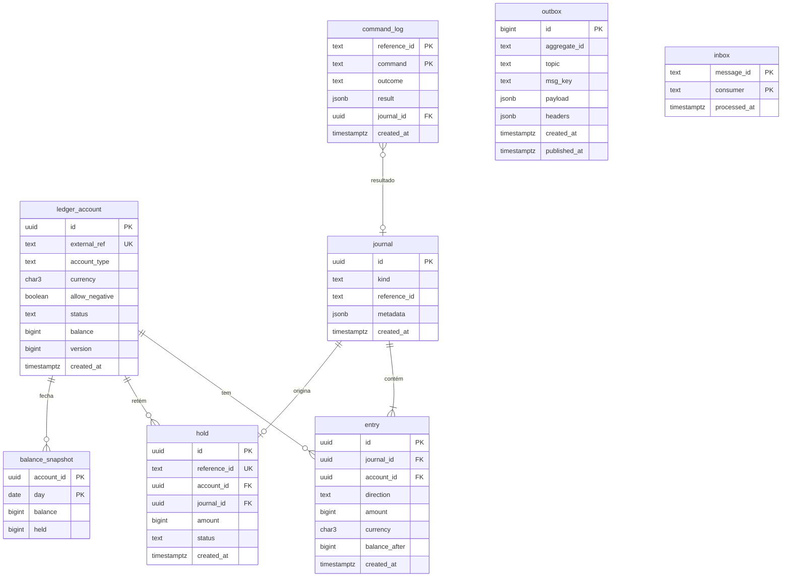

# Modelo do `ledger-service`

Genérico, sem conceitos de Pix ([ADR-0009](../adr/0009-ledger-design.md)).

## Modelo de domínio (UML de classes)



**Invariantes:** (1) por journal, Σ débitos = Σ créditos; (2) `balance` da conta = Σ entries da conta (com sinal pela natureza); (3) `CUSTOMER` com `allowNegative=false` nunca fica negativa; (4) no máximo um `CommandLog` por (`referenceId`, `command`); (5) entries e journals nunca mudam.

## Efeito das operações no razão

Convenção simplificada (a revisar por contador): `CUSTOMER` é passivo do banco; `SETTLEMENT_TRANSIT` é conta transitória; `RESERVE` representa a reserva de liquidação.

| Operação | Débito | Crédito | Hold | Observação |
|---|---|---|---|---|
| `Hold` | `CUSTOMER` | `SETTLEMENT_TRANSIT` | cria `HELD` | Valida saldo disponível; disponível cai |
| `Settle` | `SETTLEMENT_TRANSIT` | `RESERVE` | `HELD` → `SETTLED` | Contabilidade; sem efeito no disponível do cliente |
| `Release` | `SETTLEMENT_TRANSIT` | `CUSTOMER` | `HELD` → `RELEASED` | Estorno; sem `Hold` prévio grava `NOOP` e marca suspensão |
| `Transfer` | `CUSTOMER` (origem) | `CUSTOMER` (destino) | n/a | Um único journal `INTERNAL_TRANSFER` |
| `Credit` | `RESERVE` | `CUSTOMER` | n/a | Crédito externo; origem em `metadata` opaco |

## Máquina de estados do `Hold`



## Modelo de dados (PostgreSQL do ledger)



**Restrições principais:** `CHECK (amount > 0)` em `entry`; `CHECK (balance >= 0 OR allow_negative)` em `ledger_account`; `UNIQUE (reference_id)` em `hold`; PK composta `(reference_id, command)` em `command_log`; índices em `entry (account_id, created_at)` e `journal (reference_id)`; sem permissão de UPDATE/DELETE em `journal` e `entry`.

## Contrato (esboço)

```protobuf
service Ledger {
  rpc Credit(CreditRequest) returns (CreditResponse);          // síncrono
  rpc GetBalance(GetBalanceRequest) returns (Balance);         // disponível, retido, contábil
  rpc ListEntries(ListEntriesRequest) returns (EntryPage);
}
// Comandos assíncronos (tópico pixcore.ledger.commands.v1, CloudEvents):
//   ledger.hold.requested / settle.requested / release.requested / transfer.requested
// Eventos (tópico pixcore.ledger.events.v1):
//   ledger.hold.succeeded | hold.failed(INSUFFICIENT_FUNDS | CANCELLED)
//   ledger.settled | ledger.released | ledger.transferred | ledger.credited
```
