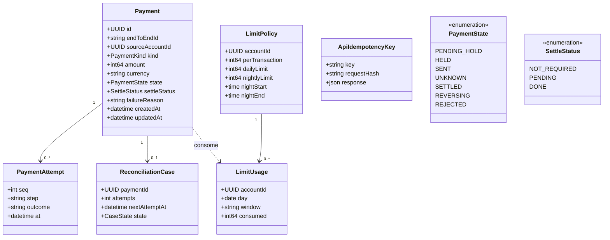
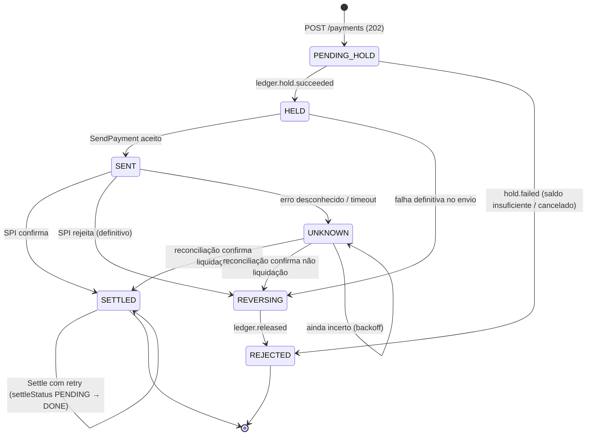
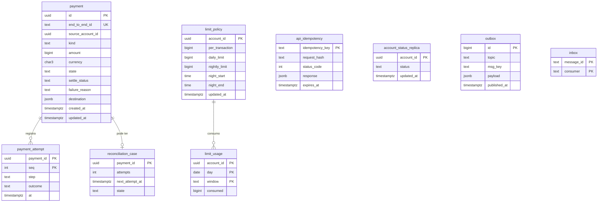
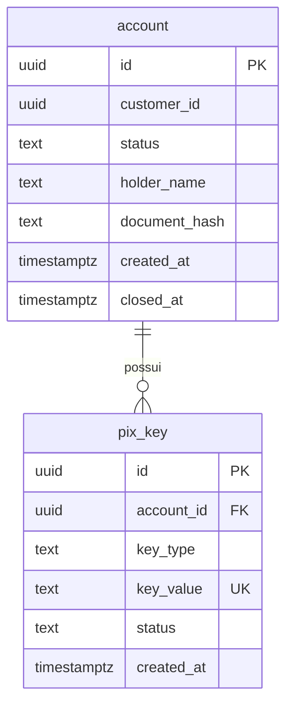

# Modelo do `payment-service`

## Modelo de domínio (UML de classes)



## Máquina de estados do pagamento enviado



Regras: `Hold` é mantido em `UNKNOWN`; `Release` só após evidência definitiva ([ADR-0005](../adr/0005-unknown-state-and-reconciliation.md)). `SETTLED` é atingido quando o SPI confirma; o `Settle` do ledger é contabilidade e segue com retry sem alterar o estado visível.

## Modelo de dados (PostgreSQL do payment-service)



Idempotência da API: `Idempotency-Key` + hash do corpo; mesma chave com corpo diferente retorna `422`; mesma chave e corpo devolve a resposta original. O consumo de limite e a criação do pagamento ocorrem na **mesma transação** local.

## Modelo do `account-service` (referência)



Estados da conta: `PENDING_KYC → ACTIVE ⇄ BLOCKED → CLOSED`. `CLOSED` dispara anonimização de PII, mantendo apenas identificadores técnicos.

## Contrato REST (esboço OpenAPI)

```yaml
openapi: 3.1.0
info: { title: PixCore Payment API, version: 1.0.0 }
paths:
  /v1/payments:
    post:
      summary: Cria pagamento Pix (assíncrono)
      parameters:
        - { name: Idempotency-Key, in: header, required: true, schema: { type: string } }
      requestBody:
        content:
          application/json:
            schema:
              type: object
              required: [sourceAccountId, amount, destination]
              properties:
                sourceAccountId: { type: string, format: uuid }
                amount: { type: integer, description: "centavos" }
                currency: { type: string, default: BRL }
                destination:
                  oneOf:
                    - { $ref: '#/components/schemas/PixKeyDestination' }
                    - { $ref: '#/components/schemas/AccountDestination' }
      responses:
        "202": { description: Aceito; estado PENDING_HOLD }
        "422": { description: Idempotency-Key reutilizada com corpo diferente }
  /v1/payments/{id}:
    get:
      summary: Consulta estado (PENDING_HOLD, HELD, SENT, UNKNOWN, SETTLED, REVERSING, REJECTED)
```
