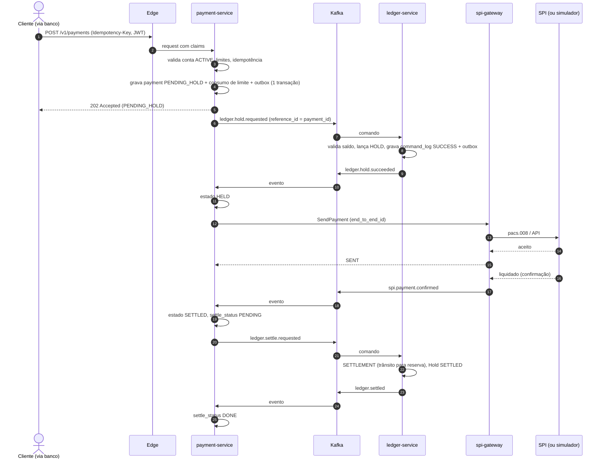
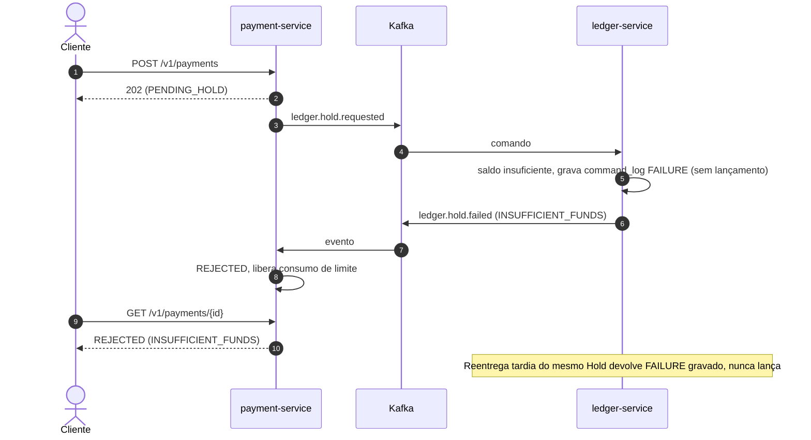
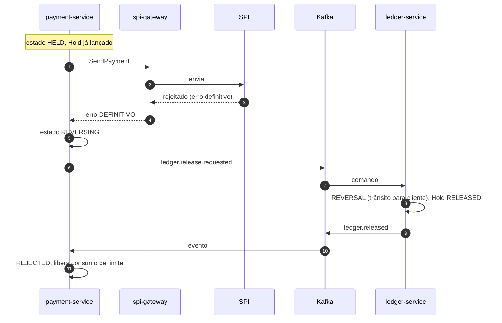
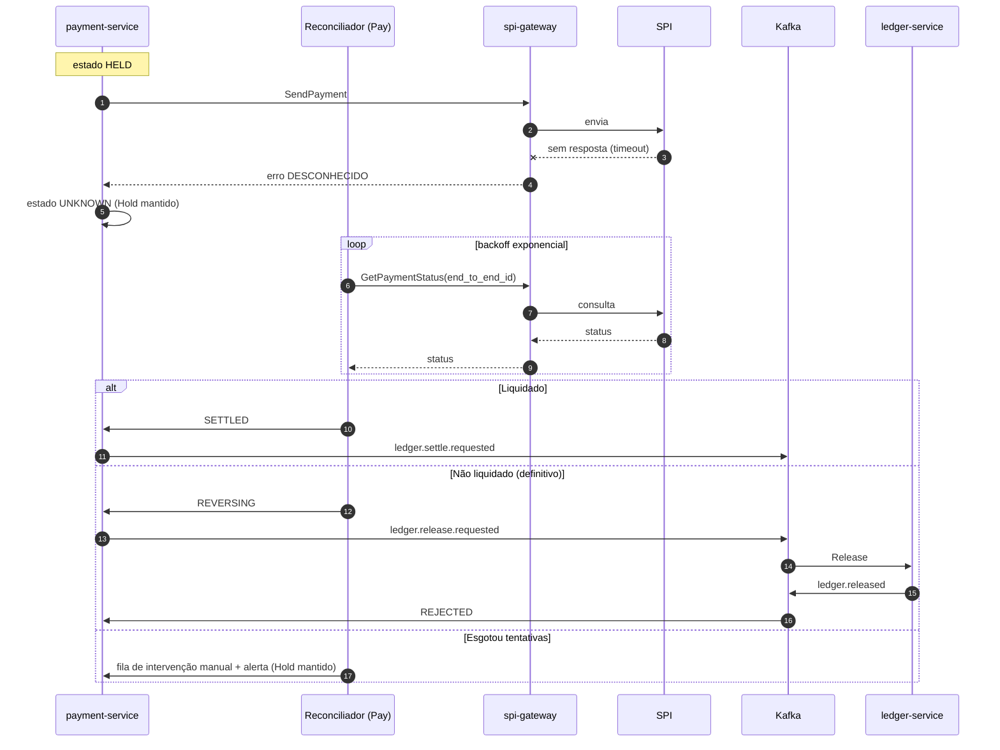
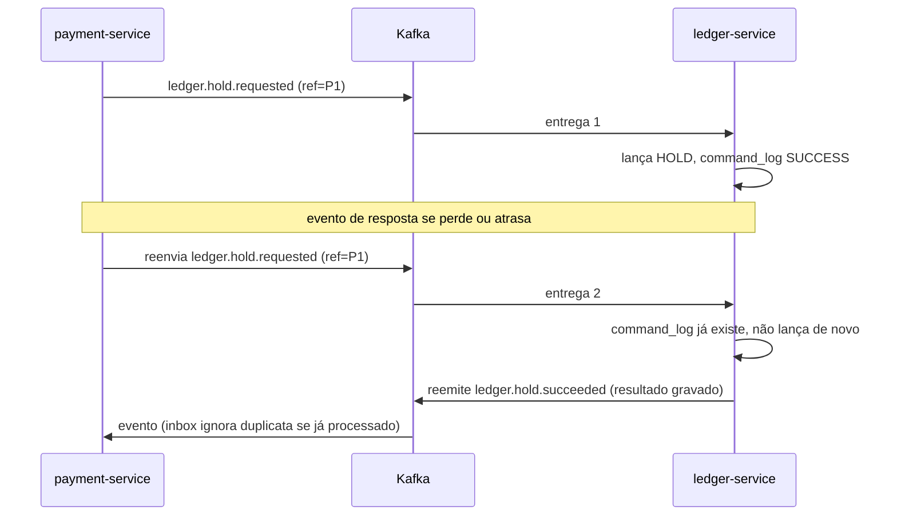
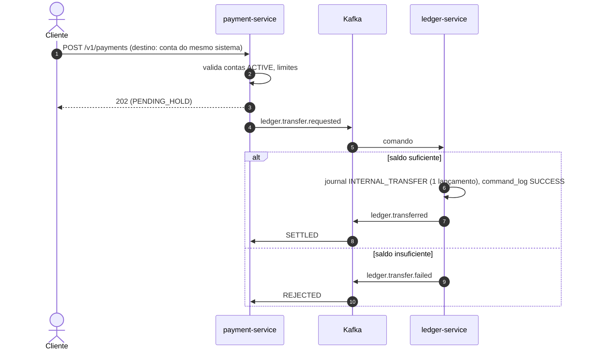
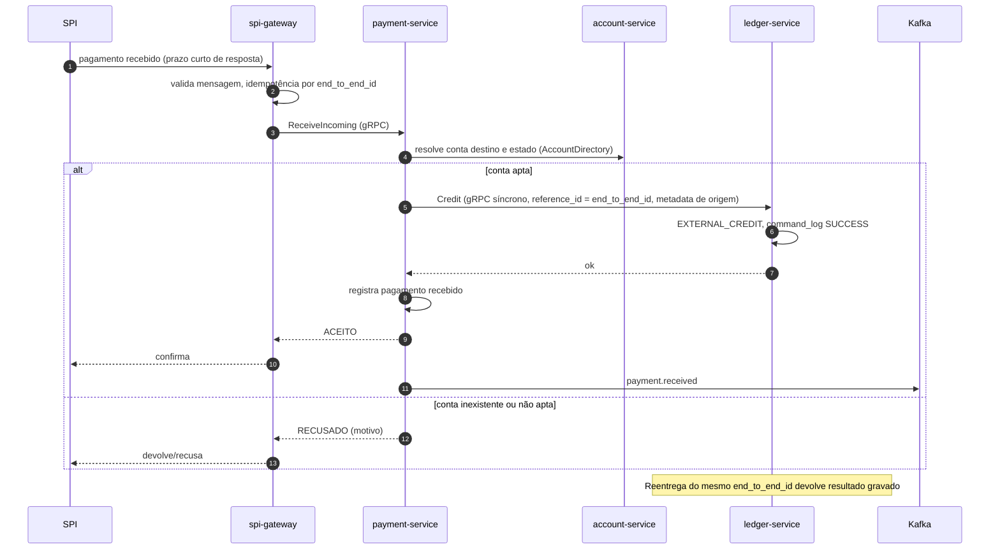
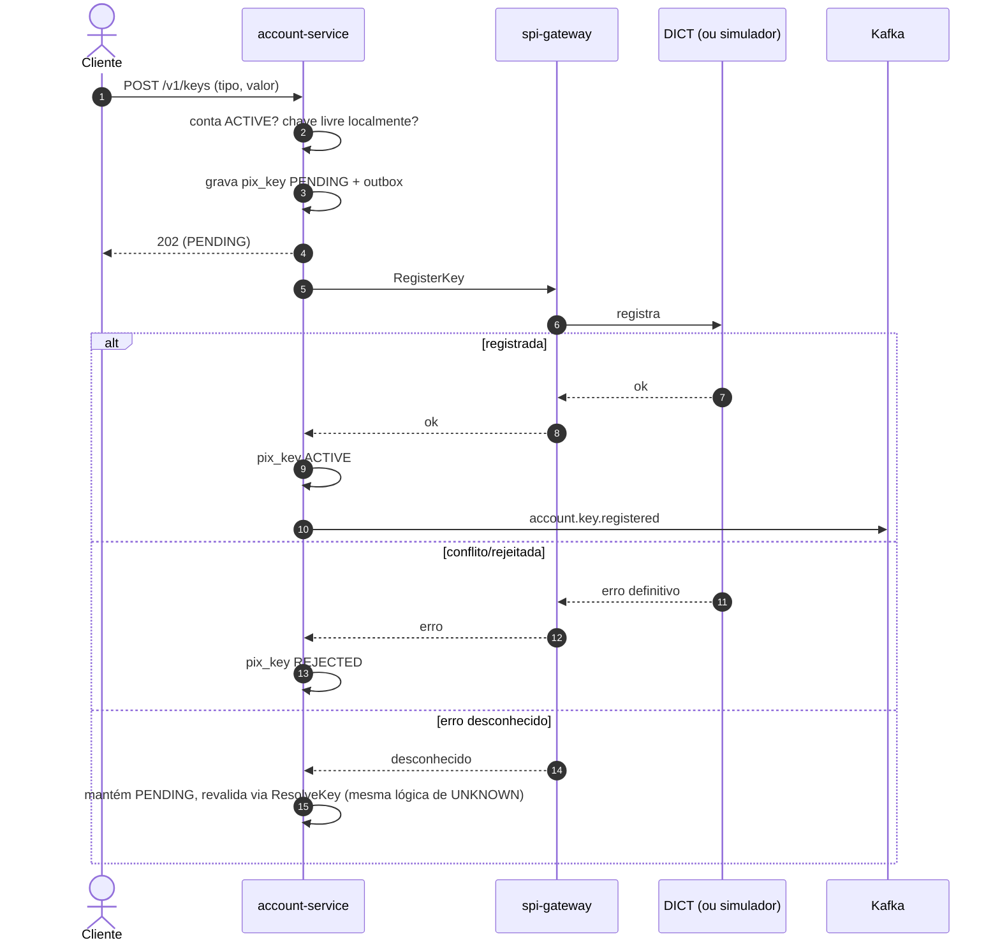

# Diagramas de sequência

Legenda: `Ledger` = `ledger-service`; `Pay` = `payment-service`; `GW` = `spi-gateway`; `Bus` = Kafka. Mensagens por `Bus` passam por outbox/inbox ([ADR-0003](../adr/0003-outbox-inbox.md)).

## 1. Pagamento enviado

### 1.1 Caminho feliz

### 1.2 Saldo insuficiente

### 1.3 Rejeição pelo SPI

### 1.4 Timeout, UNKNOWN e reconciliação

### 1.5 Reenvio de comando sem resposta do ledger

## 2. Transferência interna (sem Saga)

## 3. Pix recebido

## 4. Cadastro de chave Pix

