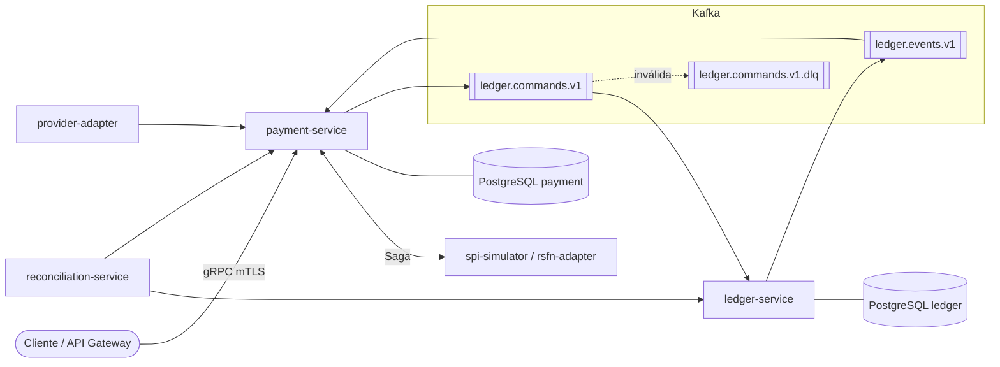
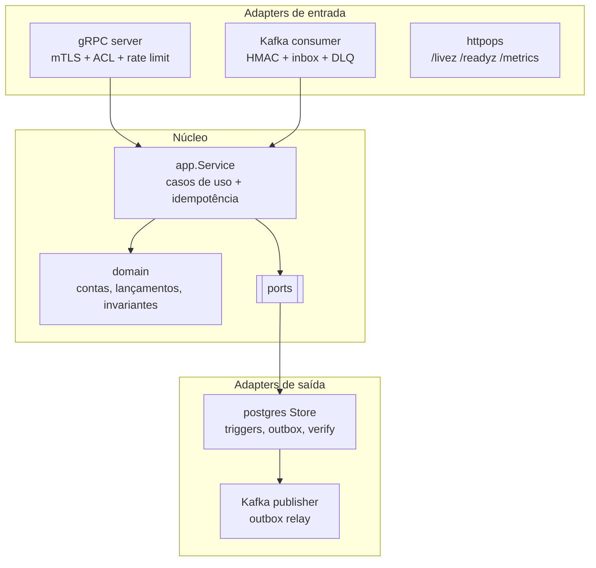
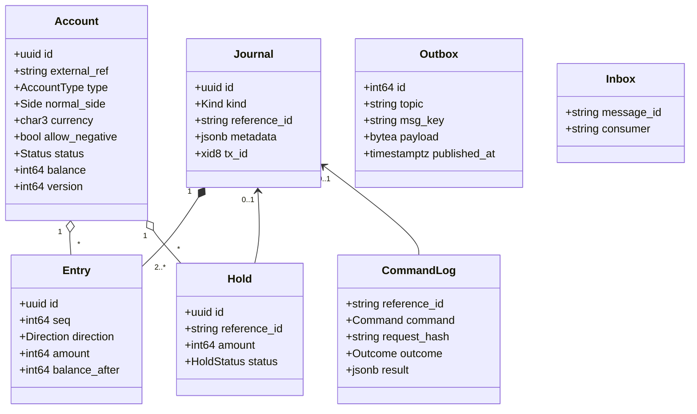
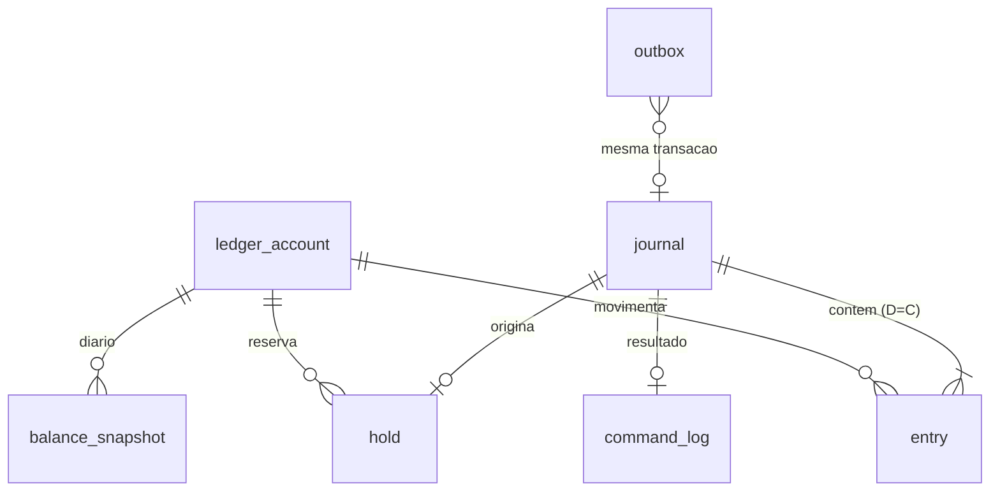
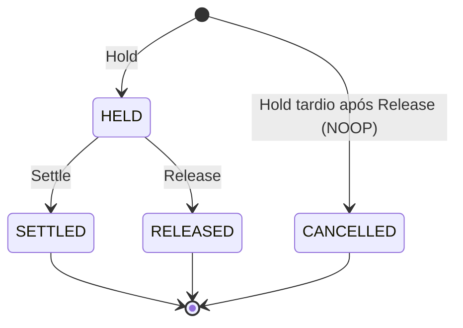
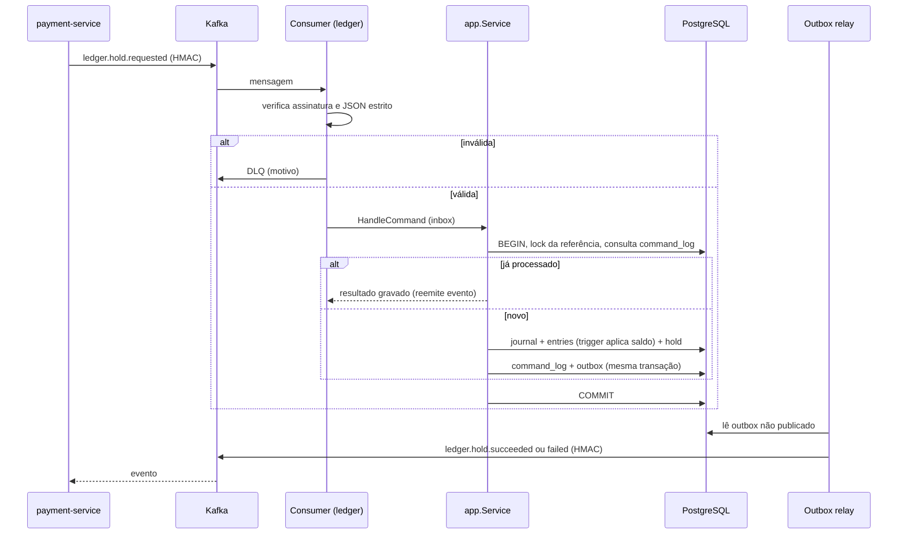
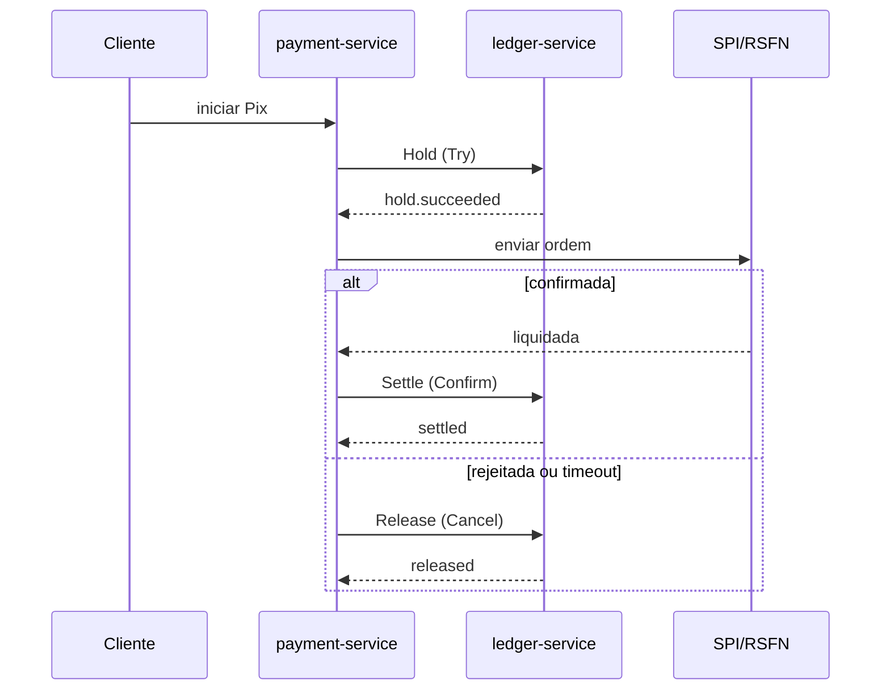
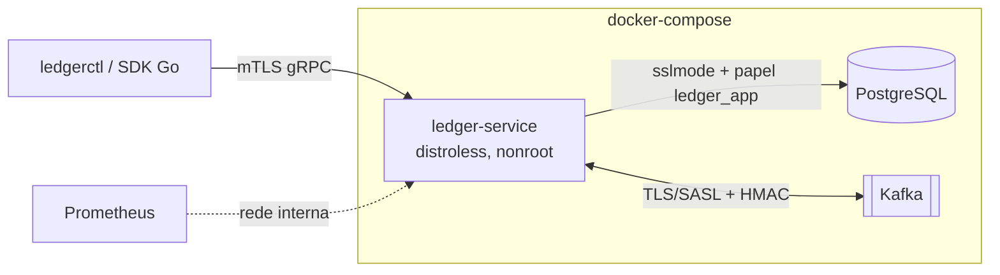
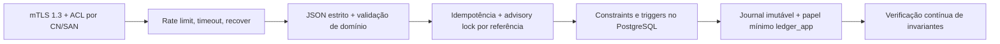

# PixCore

Infraestrutura *bank-in-a-box* (Go) para pagamentos Pix, descrita em [Docs/](Docs/). Implementação por etapas do roadmap
([production-readiness](Docs/production-readiness.md)).

| Etapa | Estado |
|---|---|
| 1. `ledger-service` + testes de propriedade + SDK Go | **Implementada** (este repositório) |
| 2. `payment-service` + `spi-simulator` (Saga) | Pendente |
| 3. Reconciliação + caos | Pendente |
| 4. Adapters `provider` / `rsfn` | Pendente |
| 5. Hardening (carga, restore, runbooks, revisão externa) | Pendente |

## Sumário

1. [Arquitetura](#arquitetura)
2. [Estrutura do repositório](#estrutura-do-repositório)
3. [Uso rápido](#uso-rápido)
4. [ledger-service](#ledger-service)
5. [Modelagem](#modelagem-do-domínio)
6. [Fluxos](#fluxos)
7. [Segurança](#modelo-de-segurança)
8. [Limitações](#limitações-conhecidas)

## Arquitetura

Monorepo Go (módulo `github.com/pixcore/pixcore`), **microsserviços orientados a eventos com arquitetura hexagonal**
([ADR-0001](Docs/0001-microservices-eda-hexagonal.md)). Cada serviço é dono do seu PostgreSQL; a comunicação é gRPC (mTLS)
para consultas/crédito e Kafka (CloudEvents assinados com HMAC) para a Saga. Contexto C4 em [Docs/01-c4.md](Docs/01-c4.md).

### Arquitetura alvo



> Estado: somente o `ledger-service` está implementado (Etapa 1); os demais componentes são alvo do roadmap.

### Arquitetura hexagonal do `ledger-service`



## Estrutura do repositório

```
api/proto/…           contrato gRPC (fonte); api/gen/… é código gerado (make proto)
libs/platform/…       events (CloudEvents + HMAC), tlsconf (mTLS), logging (redação)
services/ledger/      ledger-service (domain, app, ports, adapters, cmd, config)
sdk/go/ledger         SDK Go (gRPC + mTLS)
tools/ledgerctl       CLI operacional / demo
deploy/               Dockerfile (distroless), docker-compose de desenvolvimento
scripts/              gen-dev-certs.sh (PKI de desenvolvimento)
Docs/                 ADRs, C4, modelos, sequências, matriz de falhas, readiness
```

## Uso rápido

```bash
make test-integration   # sobe PostgreSQL + Kafka descartáveis e roda TODOS os testes (-race)
make up && make demo    # stack completa em Docker (dev) + conta/crédito/saldo via mTLS
make down
```

`make test` roda sem infraestrutura (os testes de integração são pulados sem `PIXCORE_TEST_DATABASE_URL`).

## ledger-service

Ledger de partidas dobradas genérico ([ADR-0009](Docs/0009-ledger-design.md), [ADR-0006](Docs/0006-saga-tcc.md)).

- **gRPC (mTLS + ACL):** `CreateAccount`, `GetAccount`, `SetAccountStatus`, `Credit` (síncrono), `GetBalance`, `ListEntries`
  ([ledger.proto](api/proto/pixcore/ledger/v1/ledger.proto)).
- **Comandos assíncronos** (`pixcore.ledger.commands.v1`, CloudEvents assinados com HMAC): `ledger.hold|settle|release|transfer.requested`.
- **Eventos** (`pixcore.ledger.events.v1`) via outbox transacional: `ledger.hold.succeeded|failed`, `ledger.settled`, `ledger.released`, `ledger.transferred`, `ledger.credited` e variantes `*.failed`.
- **Idempotência lógica:** `command_log (reference_id, command)` grava sucesso, falha e `NOOP`; reentrega devolve o resultado gravado e reemite o evento; mesmo `reference_id` com corpo diferente é rejeitado.
- **Empty rollback:** `Release` antes do `Hold` grava `NOOP`; o `Hold` tardio responde `CANCELLED` sem lançar.
- **Jobs:** verificação contínua das invariantes (métricas Prometheus em `/metrics`), snapshot diário, expurgo de outbox/inbox.
- **DLQ:** mensagens inválidas, sem assinatura ou fora do contrato vão para `pixcore.ledger.commands.v1.dlq`.
- **Binário:** `ledger-service serve | migrate | healthcheck`.

### Configuração (variáveis de ambiente; segredos também via `NOME_FILE`)

| Variável | Descrição |
|---|---|
| `LEDGER_ENV` | `production` (padrão) ou `development`. Produção exige DB com `sslmode=verify-full\|verify-ca`, Kafka com TLS e assinatura HMAC |
| `LEDGER_DATABASE_URL[_FILE]` | DSN do papel `ledger_app` (serviço) |
| `LEDGER_MIGRATE_DATABASE_URL[_FILE]` | DSN do dono do schema (somente `ledger-service migrate`) |
| `LEDGER_TLS_CERT_FILE`, `LEDGER_TLS_KEY_FILE`, `LEDGER_TLS_CLIENT_CA_FILE` | mTLS obrigatório (TLS 1.3); o certificado é relido a cada conexão (rotação sem reinício) |
| `LEDGER_ACL_FILE` | JSON `{"<CN ou URI SAN>": ["Credit", …]}`; sem entrada = negado; arquivo vazio recusa subir |
| `LEDGER_CURRENCIES` | moedas habilitadas (padrão `BRL`) |
| `LEDGER_KAFKA_BROKERS`, `LEDGER_KAFKA_TLS_CA_FILE`, `LEDGER_KAFKA_SASL_USER`, `LEDGER_KAFKA_SASL_PASSWORD[_FILE]` | mensageria (vazio = desligada) |
| `LEDGER_HMAC_KEYS_FILE` | `{"signing_key_id":"k1","keys":{"k1":"<base64 ≥32 bytes>"}}`; várias chaves permitem rotação |
| `LEDGER_OPS_ADDR` | health/métricas (padrão `127.0.0.1:9090`; não exponha publicamente) |

### Qualidade e testes

- Unitários de domínio e eventos; integração do app (concorrência e propriedade), do PostgreSQL (invariantes no banco),
  do gRPC (mTLS/ACL) e e2e Kafka (comando assinado → ledger → outbox → evento assinado, replay e DLQ).
- `make test` (sem infraestrutura) e `make test-integration` (`-race`, PostgreSQL + Kafka descartáveis).

## Modelagem do domínio

Valores em **centavos (`bigint`)**, moeda ISO-4217. Partidas dobradas: em cada journal, débitos = créditos.

| Lançamento | Débito | Crédito |
|---|---|---|
| Hold | CUSTOMER | SETTLEMENT_TRANSIT |
| Settle | SETTLEMENT_TRANSIT | RESERVE |
| Release | SETTLEMENT_TRANSIT | CUSTOMER |
| Credit | RESERVE | CUSTOMER |
| Transfer | origem | destino |

CUSTOMER, TRANSIT e FEES são credit-normal; RESERVE e INTERNAL são debit-normal. Contas de sistema
(`system:<TYPE>:<CUR>`, `allow_negative`) são provisionadas na subida.

### Diagrama de classes (UML)



### Modelo entidade-relacionamento



### Estados do `Hold`



## Fluxos

### Comando assíncrono (idempotência, outbox, inbox)



### Saga de pagamento (alvo)

Detalhes em [Docs/04-sequences.md](Docs/04-sequences.md) e [ADR-0006](Docs/0006-saga-tcc.md).



### Componentes de implantação (dev)



## Modelo de segurança

Detalhes e limites em [Docs/ledger-security.md](Docs/ledger-security.md).



- Saldo alterado apenas por trigger `SECURITY DEFINER`; partida dobrada garantida por constraint trigger deferido.
- `UPDATE/DELETE/TRUNCATE` bloqueados em `journal`, `entry` e `command_log`, inclusive para o dono.
- Mensagens Kafka assinadas com HMAC (chaves rotacionáveis); falha de assinatura vai para a DLQ.
- Configuração de produção falha fechada (sem TLS/ACL/HMAC o serviço não sobe).

## Limitações conhecidas

- O plano de contas é simplificado e **precisa de revisão contábil** antes de uso real.
- `SETTLEMENT_TRANSIT` e `RESERVE` são linhas quentes (serializam `Hold`/`Settle` por moeda); fragmentação fica para a etapa de carga.
- Sem teste de carga, restore ensaiado ou revisão de segurança externa: o componente é **Beta** até cumprir o checklist em [production-readiness](Docs/production-readiness.md).
- Operar Pix real exige autorização do Banco Central; o projeto não substitui conformidade regulatória.
